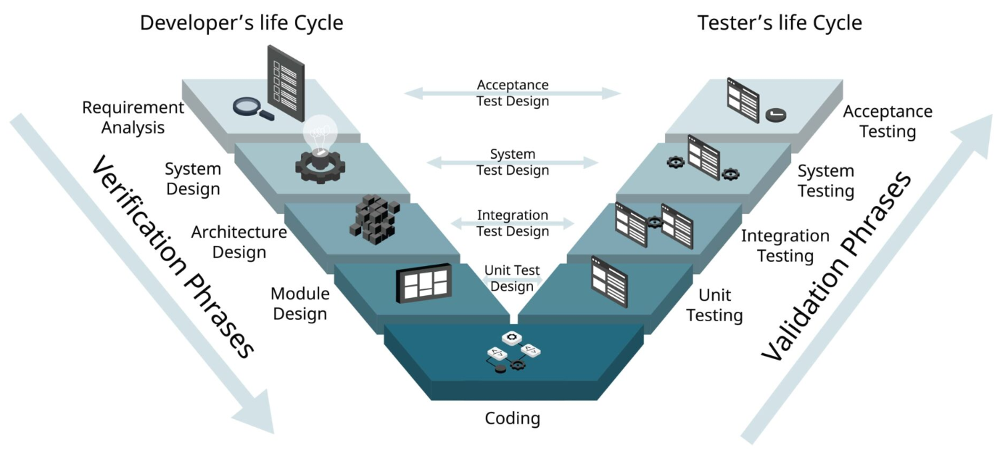

# V-Model
- V-Model là một mô hình SDLC mở rộng từ Waterfall, trong đó mỗi giai đoạn phát triển (bên trái) tương ứng trực tiếp với một giai đoạn kiểm thử (bên phải). 
- Hình dạng chữ "V" thể hiện mối quan hệ này.

## Các giai đoạn

### Bên trái — Development (Verification)

| Giai đoạn | Mô tả | Output |
|-----------|-------|--------|
| **Requirements Analysis** | Thu thập & phân tích yêu cầu từ khách hàng | SRS (Software Requirements Specification) |
| **System Design** | Thiết kế kiến trúc tổng thể hệ thống, phân chia HW/SW | System Design Document |
| **Architecture Design** | Thiết kế các module phần mềm, interfaces, data flow | HLD (High-Level Design) |
| **Detailed Design** | Thiết kế chi tiết logic từng module | LLD (Low-Level Design) |
| **Coding** | Lập trình theo LLD | Source code |

### Bên phải — Testing (Validation)

| Giai đoạn | Tương ứng với | Mục tiêu |
|-----------|--------------|---------|
| **Unit Testing** | Detailed Design (LLD) | Kiểm tra từng hàm/module riêng lẻ |
| **Integration Testing** | Architecture Design (HLD) | Kiểm tra sự tương tác giữa các module |
| **System Testing** | System Design | Kiểm tra toàn bộ hệ thống tích hợp |
| **Acceptance Testing (UAT)** | Requirements | Xác nhận hệ thống đáp ứng yêu cầu khách hàng |

---
