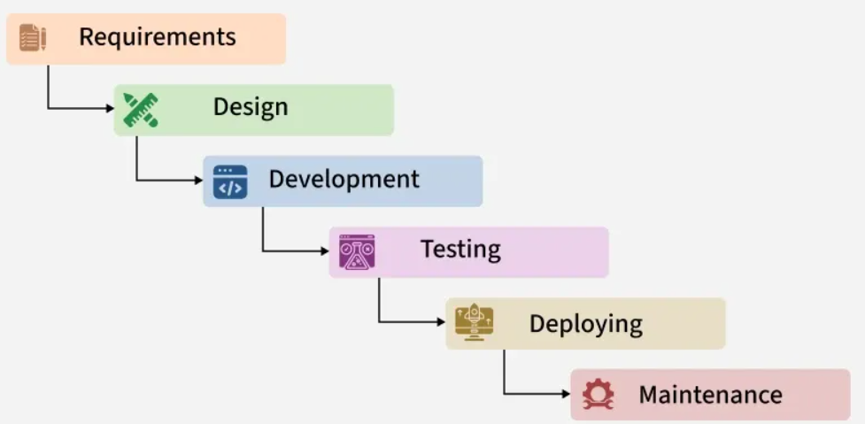

# Waterfall Model

## Tổng quan

Waterfall là mô hình SDLC **tuyến tính, tuần tự** — mỗi giai đoạn phải hoàn thành trước khi bắt đầu giai đoạn tiếp theo. 

Không có vòng lặp hay quay lại giai đoạn trước (trừ khi phát hiện lỗi nghiêm trọng).

## Các giai đoạn chi tiết

### 1. Requirements (Thu thập yêu cầu)
- Thu thập yêu cầu từ khách hàng và stakeholder
- Phân tích tính khả thi (feasibility study)
- **Output:** 
    - SRS (Software Requirements Specification), 
    - BRD (Business Requirements Document)
- **Đặc điểm:** Yêu cầu phải **đầy đủ và đóng băng** trước khi tiếp tục

### 2. System Design (Thiết kế)
- Thiết kế kiến trúc hệ thống, database, giao diện
- Chia thành HLD (High-Level Design) và LLD (Low-Level Design)
- **Output:** 
    - System Design Document
    - HLD (High-Level Design) 
    - LLD (Low-Level Design)

### 3. Implementation (Lập trình)
- Dev team viết code theo tài liệu thiết kế
- Viết unit test
- **Output:** 
    - Source code
    - UT

### 4. Testing & Verification (Kiểm thử)
- QA thực hiện: Unit Test, Integration Test, System Test, UAT
- Báo cáo bug → fix → retest
- **Output:** 
    - Test plan
    - Test cases
    - Bug report
    - Test summary

### 5. Deployment (Triển khai)
- Release sản phẩm lên môi trường production
- Đào tạo người dùng nếu cần
- **Output:** 
    - Release notes
    - Deployed system
    - User manual

### 6. Maintenance (Bảo trì)
- Sửa lỗi phát sinh sau khi release
- Cập nhật, mở rộng tính năng
- **Output:** 
    - Patches
    - Updates
    - Change requests
