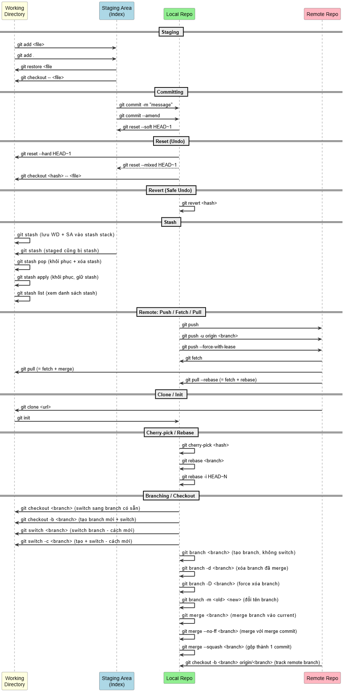

# Git Reference

## Tổng quan

|Vùng|Vị trí|Lưu ở đâu|
|-|-|-|
|Working Directory|Thư mục project trên ổ đĩa|Files bình thường, bạn edit trực tiếp|
|Staging Area|Bên trong **_index_**|File nhị phân, quản lý bởi Git|
|Local Repository|Bên trong **_objects_**|Commit history, branches, tags|
|Remote Repository|Server (GitHub, GitLab...)|Trên internet / mạng nội bộ|

```
[Máy local của bạn]
├── Working Directory   ← bạn nhìn thấy, edit được
├── .git/
│   ├── index          ← Staging Area
│   └── objects/       ← Local Repo (commits, trees, blobs)
│
[Remote Server]
└── Remote Repo        ← GitHub / GitLab / Bitbucket
```
## Git Commands Flow



---

## Files trong folder này

| File | Nội dung |
|------|---------|
| [basics.md](basics.md) | [init/clone](basics.md#khởi-tạo), [add/commit/status](basics.md#staging--committing), [log](basics.md#log), [diff](basics.md#diff) |
| [branching.md](branching.md) | [branch/checkout](branching.md#branch), [merge](branching.md#merge), [rebase](branching.md#rebase), [cherry-pick](branching.md#cherry-pick) |
| [remote.md](remote.md) | [remote](remote.md#remote-setup), [push/pull](remote.md#push--pull), [fetch](remote.md#fetch), [tracking branches](remote.md#tracking-branches) |
| [undoing.md](undoing.md) | [restore](undoing.md#git-restore----khôi-phục-file-git-223), [reset](undoing.md#git-reset----di-chuyển-head-thay-đổi-history), [revert](undoing.md#git-revert----undo-an-toàn-không-thay-đổi-history), [stash](undoing.md#git-stash----tạm-lưu-thay-đổi), [reflog](undoing.md#git-reflog----lịch-sử-đầy-đủ-cứu-data-đã-mất) |
| [advanced.md](advanced.md) | [rebase -i](advanced.md#interactive-rebase----rewrite-history), [bisect](advanced.md#git-bisect----tìm-commit-gây-bug), [worktree](advanced.md#git-worktree----nhiều-working-directory), [submodule](advanced.md#git-submodule----repo-lồng-repo), [hooks](advanced.md#git-hooks----automation) |
| [workflow.md](workflow.md) | [GitHub Flow](workflow.md#github-flow----đơn-giản-phổ-biến-nhất), [Git Flow](workflow.md#git-flow----nhiều-môi-trường), [conventional commits](workflow.md#conventional-commits) |
| [concepts.md](concepts.md) | [HEAD](concepts.md#head), [branch](concepts.md#branch), [commit](concepts.md#commit), [index](concepts.md#index-staging-area), [ref](concepts.md#ref-reference), [reflog](concepts.md#reflog), [tag](concepts.md#tag), [object model](concepts.md#tree-blob-tag-git-objects) |

---

## Tóm tắt nhanh

```bash
# Setup
git config --global user.name  "Name"
git config --global user.email "email@example.com"

# Daily workflow
git status                  → trạng thái working directory
git add .                   → stage tất cả thay đổi
git commit -m "message"     → lưu snapshot
git push                    → đẩy lên remote
git pull                    → lấy về + merge

# Branch
git checkout -b feature/xyz → tạo và switch branch mới
git merge feature/xyz       → merge vào branch hiện tại
git rebase main             → rebase branch hiện tại lên main

# Undo
git stash                   → tạm lưu thay đổi chưa commit
git reset --soft HEAD~1     → undo commit, giữ staged changes
git revert <hash>           → tạo commit ngược lại (an toàn)
```
